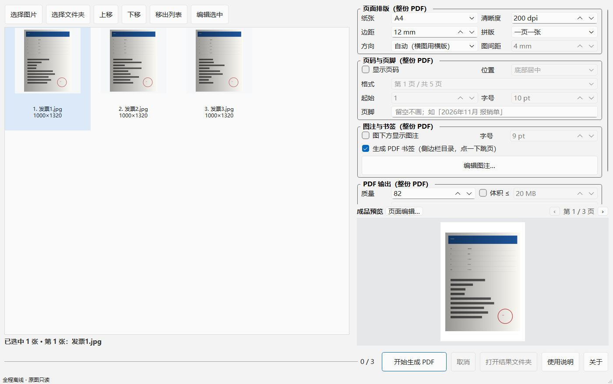

# 图片转PDF工具

> 免费下载与图文教程：<https://www.mrheedu.com/apps/image-to-pdf>　·　更多免费软件：[www.mrheedu.com](https://www.mrheedu.com)
> 把照片、截图、扫描件、书页拖进来，按你自己调的参数合成一份能直接发出去的 PDF。全程本地处理，不联网、不上传，原图一个字节都不改。

一款 Windows 桌面小工具：把手机拍的发票、证件、作业、合同、书页拼成 PDF，可自动裁边、纠偏、透视拉正、去阴影，按目标体积反推清晰度，还能单独修某一张图，在页面上写字、圈重点、遮号码、盖章——不用再开第二个软件。不登录、没有水印、没有页数限制。

- 分类：办公工具
- 版本：**1.3.0**（2026-11-11 构建）· 免安装版约 255 MB / 安装包约 67 MB（含 OpenCV 82M、Qt 43M、PyMuPDF 38M、HEIC 22M）
- 公司：深圳市创炫互动网络科技有限公司 · www.mrheedu.com
- 运行环境：Windows 10 及以上 64 位，目标机器不需要装 Python

详细介绍见 [docs/产品介绍与功能特点.md](docs/产品介绍与功能特点.md)，图文步骤见 [docs/使用教程.md](docs/使用教程.md)。

## 它解决什么

手机拍一张发票，直接丢进报销系统或邮件，通常会被打回来：歪着、有手影、一张一个文件、体积还大。用扫描仪？家里没有。用在线转换站？发票和证件恰恰最不该上传到别人服务器。

这个工具把「把照片修成扫描件」和「合成 PDF」放在同一个本地流程里做完。

```
手机拍 / 微信收 ──► 图片转PDF工具 ──► 报销系统 / 办事窗口 / 邮件附件 / 作业提交
```

## v1.3.0：缩略图列表 + 页面排版 + 成品预览 + 一个编辑窗口

之前版本把参数铺满窗口上沿、右侧再挂一块常驻预览，顶部还有一排「一键填值」场景按钮，信息太密。v1.3.0 按「先看到图、再谈参数」重排；主窗体现在只做三件事：**列表选择、页面排版、预览**。

- **左边是缩略图列表**：拖入即出图，拖动卡片改页序，双击（或点「编辑选中」）进编辑窗口；
- **右边全是「整份 PDF」的事**：「页面排版」（纸张 / 清晰度 / 边距 / 拼版 / 方向 / 图间距）、「页码与页脚」（页码开关、位置、格式、起始页号、字号、一行页脚文字）、「图注与书签」（图片下方那行小字 + 阅读器侧边栏目录）和「PDF 输出」（JPEG 质量 / 体积上限 / 最低画质 / 保存到），下面是成品预览——待生成的那份 PDF 的一页，`‹ ›` 翻页，改参数自动重排；
- **成品预览只负责「看一眼」**：右栏那一页是待生成的 PDF 的第几页，`‹ ›` 翻页，改参数自动重排。它只有三百来像素高，看清版式够用，动手改地方就点旁边的「**页面编辑…**」；
- **页面编辑是一个独立大窗口**：整页铺满一屏，图可以拖着换位置、拖四角改大小（锁原图比例），配「居中 / 铺满 / 复位本页」；同一排工具还能往纸上**加文字、画方框、拉箭头、涂黑遮盖、贴签名图**，都能拖、能改字号颜色、能删。**画错了 Ctrl+Z 撤销、Ctrl+Y 重做**，最多回退 60 步。PageUp / PageDown 翻页，点「完成」回主界面；
- **单张的事只在「编辑选中」窗口里**：裁边 / 纠偏 / 透视拉正 / 去阴影 / 画面效果，前三项默认不勾（不擅自动原图）。不勾「同时用于其它图片」只改这一张，勾上就是这一批的默认值。这个窗口里没有任何页码、体积、目录的设置——两边不重叠；
- **应用时顺手存图**：把处理后的图写进原图旁的 `out`（全分辨率、同名覆盖），改完当场就能拿到图，不用先生成 PDF；
- **编辑过的图优先**：再次出片时，`out` 里那张修改后的图直接当成品用；没编辑过的仍按参数处理原图；
- **纸张可选「自适应」**：页面跟着图片比例走，书页、长图、横幅、截图不会被压进 A4。



## 快速开始（图形界面）

1. 双击 `图片转PDF工具.exe`（或安装包装好的快捷方式）。
2. 把图片 / 文件夹拖进**左侧**，或点「选择图片」「选择文件夹」。
3. 在右边调纸张 / 清晰度 / 边距 / 拼版；要页码就在「页码与页脚」里勾「显示页码」，页脚可以写一行小字；要每张图带说明就在「图注与书签」里勾「图下方显示图注」，点「编辑图注…」逐张写。下面的「成品预览」就是会生成的那一页，`‹ ›` 翻页。
4. 想让这一页的图挪个位置、改大改小，或要在纸上写字圈重点，点成品预览旁的「**页面编辑…**」——会弹出一个大窗口，整页铺满一屏。拖图、拖四角、加文字 / 方框 / 箭头 / 涂黑 / 签名图都在里面，不满意点「复位本页」，改完点「完成」。
5. 只有某一张拍歪了 / 有阴影，才选中它点「编辑选中」：画布即时显示效果、参数一改立即重算，画布干净、不做任何拖拽变形；满意再「应用」；勾上「同时用于其它图片」就是整批生效。
6. 点「开始生成 PDF」。结果默认落在第一张图旁边的 `out` 文件夹，做完自动打开。

> 分工只有一句：**右栏 = 整份 PDF，编辑窗口 = 单张图片，页面编辑窗口 = 这一页怎么摆、纸上写什么**。要改页码、清晰度、体积、存哪儿，永远在右栏；要改这一张的裁边、纠偏、去阴影、画面效果，才进编辑窗口；要摆位置、加标注，才开页面编辑窗口。它不另存副本，只改「这张在它那一页上摆在哪」和「纸面上多出来什么」，页序仍由左边列表决定。

批量、页序、体积、去阴影、拼版的具体调法见 [使用教程](docs/使用教程.md)。

## 参数一览

| 参数 | 可选项 | 默认 | 范围 |
|---|---|---|---|
| 纸张 | A4 / A5 / B5 / Letter / 自适应 | A4 | 整批 |
| 清晰度 | 72–600 dpi | 200 dpi | 整批 |
| 边距 | 0–40 mm | 12 mm | 整批 |
| 拼版 | 一页一张 / 上下两张 / 左右两张 / 2×2 四张 | 一页一张 | 整批 |
| 页面方向 | 自动（横图用横版）/ 始终竖版 / 始终横版 | 自动 | 整批 |
| 图间距 | 0–20 mm | 4 mm | 整批（一页多张时才有意义） |
| 页码 | 开 / 关 | 关 | 整批 |
| 页码位置 | 底部居中 / 右下 / 左下 / 顶部居中 / 右上 / 左上 | 底部居中 | 整批 |
| 页码格式 | `1` / `1 / 5` / `第 1 页` / `第 1 页 / 共 5 页` | 第 1 页 / 共 5 页 | 整批 |
| 起始页号 | 0–9999 | 1 | 整批 |
| 页码字号 | 6–24 pt | 10 pt | 整批 |
| 页脚文字 | 一行自定义文字，留空不画 | 空 | 整批 |
| 图注 | 开 / 关（每张图下方一行小字） | 关 | 整批 |
| 图注字号 | 6–18 pt | 9 pt | 整批 |
| PDF 书签 | 开 / 关（侧边栏目录，一图一项） | 开 | 整批 |
| 裁边 / 纠偏 / 透视拉正 | 三个独立开关 | 界面默认全不勾 | 整批默认 + 可逐张覆盖 |
| 去阴影 | 关 / 轻 / 标准 / 强 | 关 | 整批默认 + 可逐张覆盖 |
| 画面效果 | 彩色 / 彩色扫描件（拍照修复）/ 增强（扫描件）/ 灰度 / 黑白（1 位无损） | 彩色 | 整批默认 + 可逐张覆盖 |
| JPEG 质量 | 40–95 | 82 | 整批 |
| 目标体积 | 限制 + MB 数（1–500） | 不限制 | 整批 |
| 最低画质 | 打印可辨认 150 dpi / 屏幕可看 96 dpi | 150 dpi | 整批 |
| 输出目录 | 任意文件夹 | 第一张图旁边的 `out` | 整批 |

| 改的是谁 | 在哪改 | 有哪些 |
|---|---|---|
| **整份 PDF** | 主窗体右栏「页面排版」「页码与页脚」「图注与书签」「PDF 输出」 | 纸张、清晰度、边距、拼版、页面方向、图间距、页码、页脚、图注、书签、JPEG 质量、体积上限、最低画质、保存目录 |
| **单张图片** | 「编辑选中」窗口 | 裁边、纠偏、透视拉正、去阴影、画面效果 |
| **单张在页面上的位置** | 「页面编辑…」窗口 | 拖动换位置、拖角改大小、居中、铺满、复位本页 |
| **纸面上除图片之外的东西** | 「页面编辑…」窗口的工具条 | 文字块、方框、箭头、涂黑遮盖、签名图 |

页码用 PDF 内置中文字体，一本多页 PDF 只多几 KB，不会为了几个数字把整套中文字库塞进去——这点和「体积上限」直接相关，所以是刻意选的。

单张覆盖只涉及图片本身：裁边、纠偏、透视拉正、去阴影、画面效果。页面与输出（纸张、拼版、清晰度、体积、目录）始终是整本的——否则页码和体积阶梯会失去意义。

**图注不是照抄文件名。** 文件名大多长成 `IMG_20261109_124512`、`微信图片_20261109124512`，印在纸上对读者没有信息量，还顺手暴露拍摄时间。所以勾上「图下方显示图注」之后，程序先把文件名洗干净再用：去掉相机 / 微信 / 截图的前缀和时间戳、把下划线换成空格；洗完什么都不剩（整串都是日期编号）就干脆不画，不会在纸上印一串数字。真要在纸上写「这是什么」，点「编辑图注…」逐张填，留空的那张仍按文件名。

**书签是另一件事，默认开着。** 它写进 PDF 大纲，阅读器侧边栏一图一项，点一下跳到那一页；不占版面，几十项也只多几 KB。几十页的扫描件里要找「那张发票」，靠它比在纸上找字快得多。两者互相独立：图注关掉，书签照旧。

图注会让版心让出一条带（和页码同样的做法），所以勾上图注后图会小一点点；一页多张时按「这一页有没有字」整页统一让，不会一张大一张小。

## 页面编辑（独立窗口，整页铺满一屏）

「拼版」只是给出一个默认摆法：一页一张铺满、两张上下、四张 2×2。真实材料经常不听话——身份证反面要摆正、票据想缩一点让两页内容对齐、截图想留白写字。这些动作需要看清纸面，所以不在右栏那块小预览里做，而是另开一个窗口：

1. 点成品预览旁的「**页面编辑…**」，弹出一个 1240×900 的窗口（笔记本上按屏幕缩），整页铺满一屏，右边那一页就是出片时的那一页；
2. 默认是「**选择**」：点一张图选中（选中框带四个角点），拖着它换位置；
3. 拖**四角**改大小，图的比例锁死，不会拉变形；
4. 方向键微移 1 pt，`Shift` + 方向键 10 pt；
5. 「**居中**」「**铺满**」一键摆到页面中线 / 撑满版心；「**复位本页**」把这一页的图退回自动落格，并清掉本页的文字 / 方框 / 箭头 / 涂黑 / 签名图（会先弹窗确认，后悔按 Ctrl+Z 能整个找回来）；
6. `PageUp` / `PageDown` 换页，点「**完成**」回主界面——改动已经记下了，不用另存；
7. 哪一步画错了：`Ctrl+Z` 撤销、`Ctrl+Y` 重做，也可以用工具条第二行最左边的「**撤销**」「**重做**」。挪图、拖角、改字号颜色、改文字、删除、加标注都能退回，最多 60 步。

### 纸上除了图，还能写能画

同一排工具就是「这台电脑里不用再开第二个软件」的那部分——批合同、圈重点、遮号码、盖章，都在这张纸上完成：

| 工具 | 怎么用 | 典型场景 |
|---|---|---|
| **文字** | 在纸上拖一个框，松手填字；只点一下也行，会自动给一行宽的框 | 合同「此页无正文」、报销单合计、作业评语、签署日期 |
| **方框** | 拖出矩形，可拉成任意长宽 | 圈出金额、圈出错误处 |
| **箭头** | 从起点拖到终点，方向长短随意（水平、垂直、斜线都行）；选中后拖两端调整，粗细可选 | 指向某个数字、指引签字位置 |
| **涂黑** | 拖出矩形，出片时是实心色块 | 遮身份证号、手机号、银行卡号 |
| **签名图** | 拖出位置后选一张 PNG / JPG | 签名、电子章、手写批注截图 |

选中的标注会带绿色角点：能拖、能拖角改大小、能按 `Delete` 删；文字双击（或点工具条上的「**改字**」）可以改内容，改个字不用删了重画。**拿着某个工具点一下纸上已有的标注（五种都一样）= 选中它**，工具随即退回「选择」，接着就能拖、能拖角、能删；反过来说，画完发现框歪了，**从框里直接拖就是移动它**，不会再叠一条。字号和颜色在上方一行，改的是「选中的那一条」；没选中时改的是「下一条的默认值」。涂黑固定用纯黑——叫涂黑结果出来是红条，谁都以为出错了；真要白色遮盖，选中它再把颜色改白。

几条规则，都是为了不让「编辑」变成新的坑：

- **只在版心里挪图**。拖到纸边会自动停在边距上，不会压进页码那条带——否则打印出来页码被图盖住，你还得回来找原因。
- **换页不靠拖**。位置只决定「这张在它那一页上摆在哪」，第几页仍由左边列表的顺序定。要换页就拖缩略图或点「上移 / 下移」。
- **比例存储**。位置和标注都记页面比例（0–1），换纸型、改边距、改清晰度之后还在原来的相对位置，不会跑到纸外。
- **和成品一致**。手动位置进的是出片同一条代码路径（`render_page`），标注进的是 `core/annotate.py` 的同一套换算，预览里看到的矩形就是 PDF 里的矩形；`report.json` 的 `per_image_places` 和 `annotations` 里能查到每一处。
- **标注是矢量，改它不重排**。所以拖动、改字号、改颜色都是即时的，不会因为改一个字等半秒重排整页。
- **涂黑是覆盖，不是删除**。本工具输出的是图片型 PDF，涂黑块盖在图上，看得见的部分确实看不到；但如果有人拿编辑器把黑块移走，底下原图还在。要彻底干净，先用图片编辑把信息抹掉再进这个流程。
- **撤销只活在这次运行里**。栈在内存里，关掉程序就没了；换图 / 改页序时也会清空（那时位置和页号已经对不上，硬撤回去只会更乱）。
- 「自适应」纸张下**拖不了图**（那种页面本身就是这张图，没有腾挪余地），**但标注照样能加**——书页、长图上的批注不受影响。

## 命令行（无需 PySide6 界面也能跑完整引擎）

```bash
# 通用默认：结果在第一张图旁边的 out
python cli.py 图片或文件夹

# 一键填票据推荐值 + 整批压到 20MB
python cli.py ./票据 --preset receipt --target 20

# 证件正反面左右并排、300dpi
python cli.py ./证件 --preset idcard

# 书页 / 长图：纸张跟着图片比例走，只关透视拉正
python cli.py ./书页 --paper 自适应 --no-perspective

# 纯文字黑白稿，体积最小
python cli.py ./作业 --color bw --no-geometry
# 手机拍的文件做成扫描件效果（增强 + 轻度去阴影）
python cli.py ./书页 --color enhance --shadow light

# 其它
python cli.py ./票据 --per-page 4 --shadow light --floor 96 --json
python cli.py --version
```

`--preset` 默认 `general`；其余可用参数：`--dpi --margin --per-page --shadow --color --quality --floor --max-angle --orientation --no-landscape --no-crop --no-deskew --no-perspective --out --name --json`。`--json` 会把完整报告打到标准输出，方便脚本接。

命令行没有逐张覆盖开关——那是图形界面的交互，逐张处理请用 GUI。

## 输出与可靠性

- 输出 PDF（彩色 / 增强 / 灰度内嵌 JPEG，黑白为 1 位无损 PNG）+ 同目录 `report.json` 逐张报告；报告里 `per_image_tunes` 记着哪张单独修过、修了什么。
- **原图只读**：转换前算指纹、转换后核 `src_check`，从不写回；「移出列表」不删文件。
- **原子写盘**：先写 `.part` 再改名，中途失败不留半截 PDF；同名输出自动加 `(1)`；每个 PDF 配一份自己的同名报告，不覆盖上一批。
- **体积反推**：按实测体积最多试 4 轮降 DPI / 质量，压到画质地板就停；跨轮复用增强结果，不重复跑图像算法。
- **源图不够大**：按原像素出片并写明实际 DPI，不放大凑数。
- **格式**：JPG / PNG / WEBP / BMP / TIF / HEIC；中文路径、HEIC 往返、EXIF 转正与自然排序都有自检覆盖。
- **0 联网**：核心代码静态扫描 + 运行期计数双重核验，界面底部显示结论。
- **可取消**：取消不留 PDF、参数解锁、状态栏说明进度。

## 安装

- **免安装版**：解压后双击 `图片转PDF工具.exe`，不写注册表。
- **安装包**：装到当前用户的 `%LOCALAPPDATA%\Programs\图片转PDF工具`，无 UAC、无「查阅 README」勾选、不擅自建桌面图标。
- **装到联接盘的机器**：若 `%LOCALAPPDATA%\Programs` 被做成 junction 指向别的盘，Windows 的 RedirectionGuard 会让全新安装报「错误 448：无法遍历路径，因为它包含不受信任的装入点」。安装包已设 `RedirectionGuard=no` 规避（每用户安装、`{app}` 本就归用户自己所有，不涉及它要防的提权路径）。
- 验证安装：`图片转PDF工具.exe --selftest` 跑一次真实转换 + HEIC 往返 + 逐张覆盖 + 0 联网自检。

## 开发与验收

```bash
pip install -r requirements.txt pyinstaller

python verify.py                 # 核心引擎自检（425 项）
python tools/ui_test.py          # 界面自检（266 项，真的建窗口、点按钮、拖缩略图、拖标注、撤销重做、跑线程）
python main.py --selftest        # 出厂包自检（22 项）
python cli.py --version
python tools/make_docs_shots.py  # 真桌面重截 docs/screenshots/*.png（不能用 offscreen，中文会变方框）
python tools/installer_ui_check.py "dist/安装包/图片转PDF工具-1.3.0-安装包.exe"   # 安装/运行/关窗口/卸载 9 项
```

打包：

```bash
build_installer.bat            # 一步出免安装版 + 安装包
# 或分开：
build_exe.bat                  # dist\图片转PDF工具\（约 255MB）
"C:\...\Inno Setup 6\ISCC.exe" installer.iss   # dist\安装包\图片转PDF工具-1.3.0-安装包.exe（约 67MB）
```

版本号只需改三处：`core/about.py` 的 `APP_VERSION`、`installer.iss` 的 `MyAppVersion` / `VersionInfoVersion`、`tools/pyinstaller_version.txt`；`build.spec` 统一过滤掉 `onnxruntime`、PyMuPDF 版面模型与视频 ffmpeg DLL 以控制体积。

目录结构：

```
core/         imaging / pdfbuild / converter / presets / annotate / about / compliance
main.py       PySide6 主界面（缩略列表、整份 PDF 的页面与输出、成品预览、页面编辑窗口、单张编辑窗口）
cli.py        命令行入口
verify.py      引擎自检
tools/        界面自检、截图、安装包 UI 检查、图标、版本资源
docs/         产品介绍、使用教程、截图
教程MD/       三篇分场景图文教程
resources/    app.ico
```

## 已知边界

去阴影与透视是**基于估计的图像处理**：褶皱纸、强反光、纸张透字不保证救得回来，以编辑窗口画布上看到的效果为准，不满意就把对应开关关掉，或只给这一张改参数。开启「目标体积」后成品可能比预览略糊，界面会提前写明。500 张规模尚未做专项压测。

页面编辑窗口的大小在同一次运行里记住（拖大一次，下次打开还是那么大），但**不写进注册表**——关掉程序就回到默认的 1240×900。

本软件**不做** OCR 文字识别、可编辑文字层、PDF 加密 / 水印、多 PDF 合并拆分；也**不做自由手绘涂鸦**——鼠标写字难看，还要处理撤销、缩放后的线宽失真、路径落进 PDF 后无法再选中编辑。同样想标一个地方，方框、箭头、文字块可拖可改可删，矢量进 PDF，够用且不出错。

## 许可

免费软件，纯本地使用；不收集、不上传任何图片或文件。

---

## 更多免费软件

本工具由深圳市创炫互动网络科技有限公司开发，官网提供免费安装包、图文教程，以及更多永久免费的 Windows 软件：**[www.mrheedu.com](https://www.mrheedu.com)**
