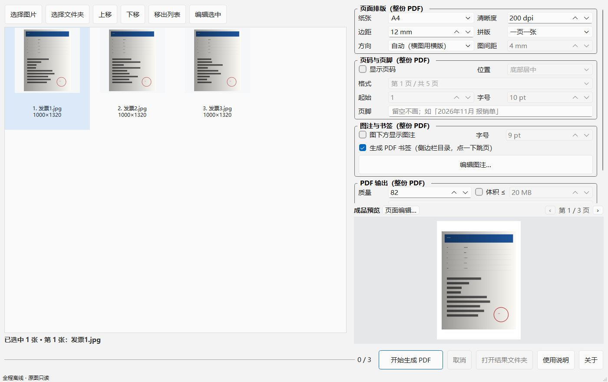
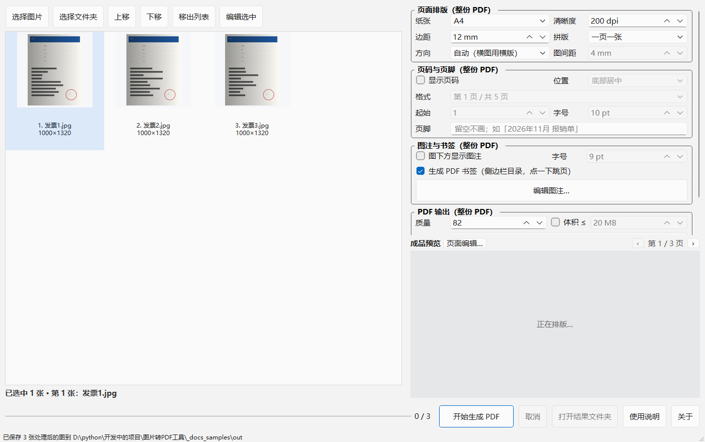
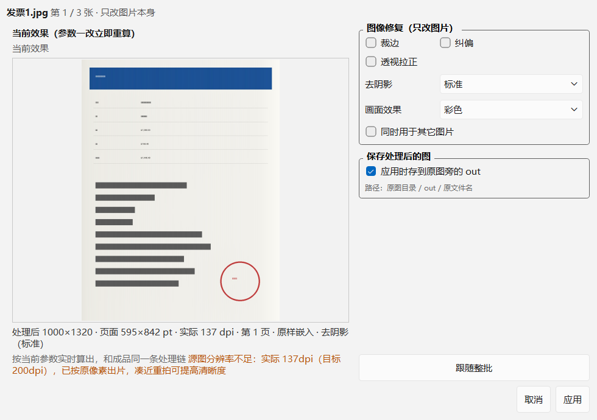
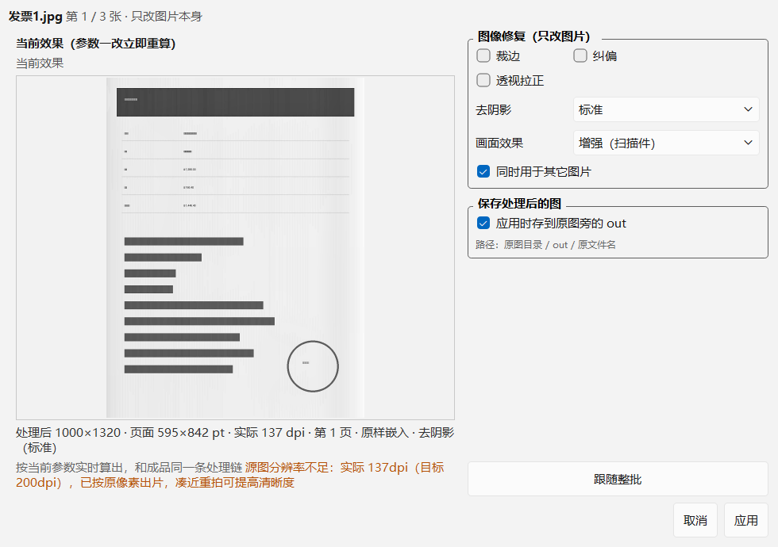
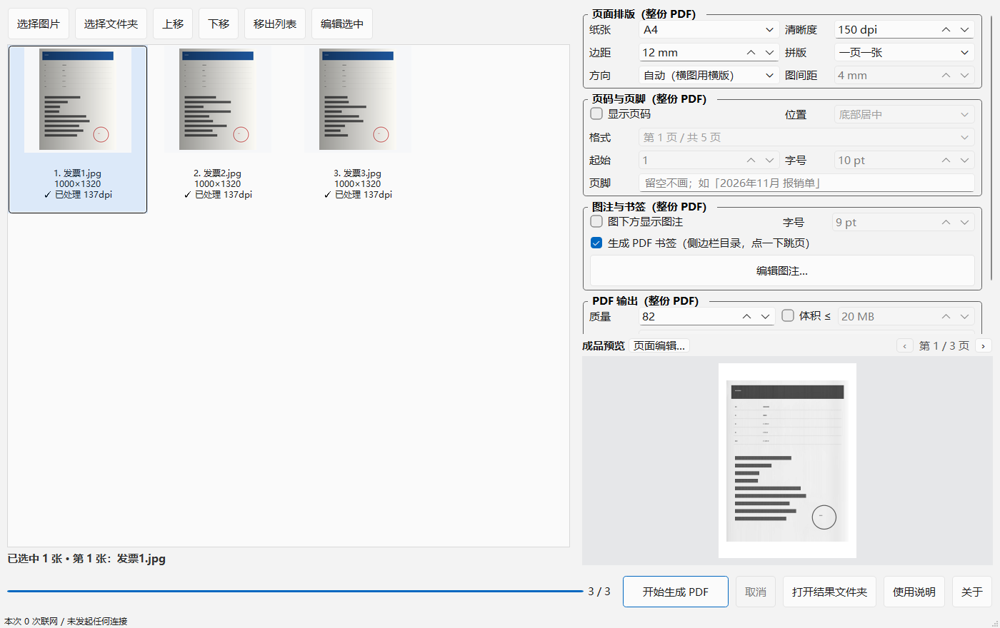
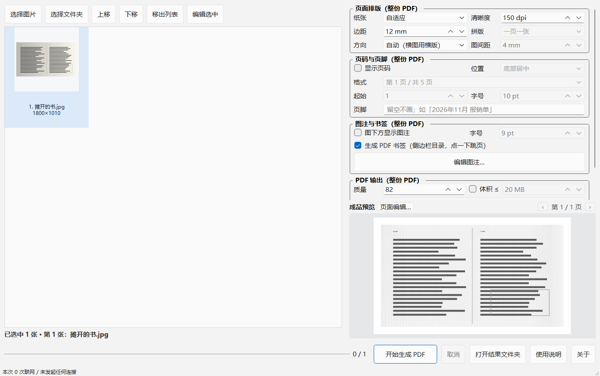
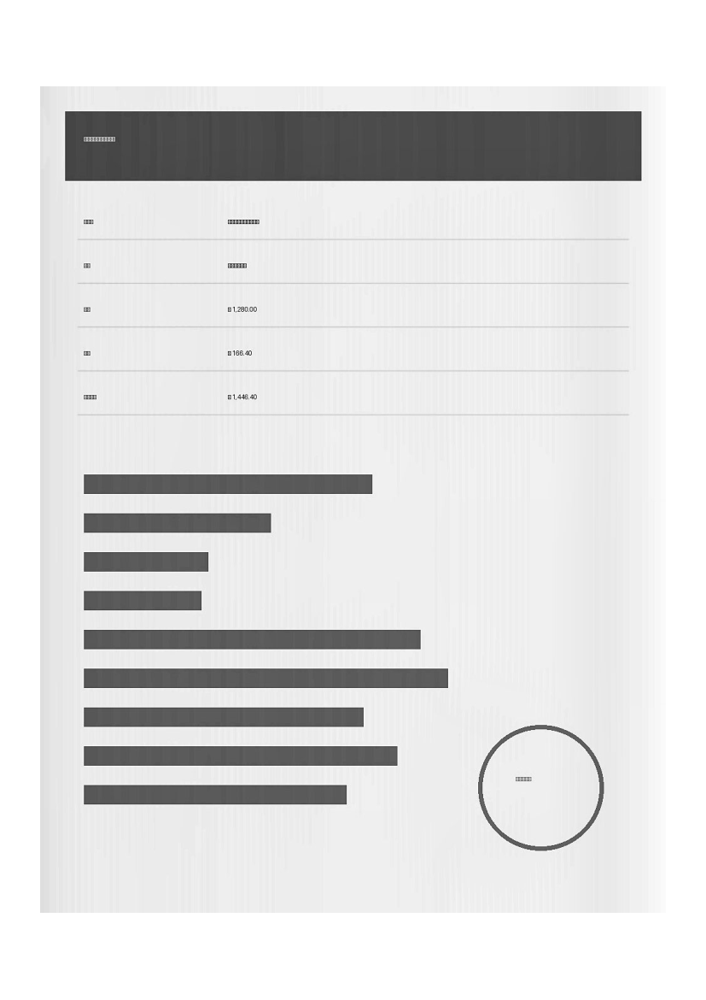
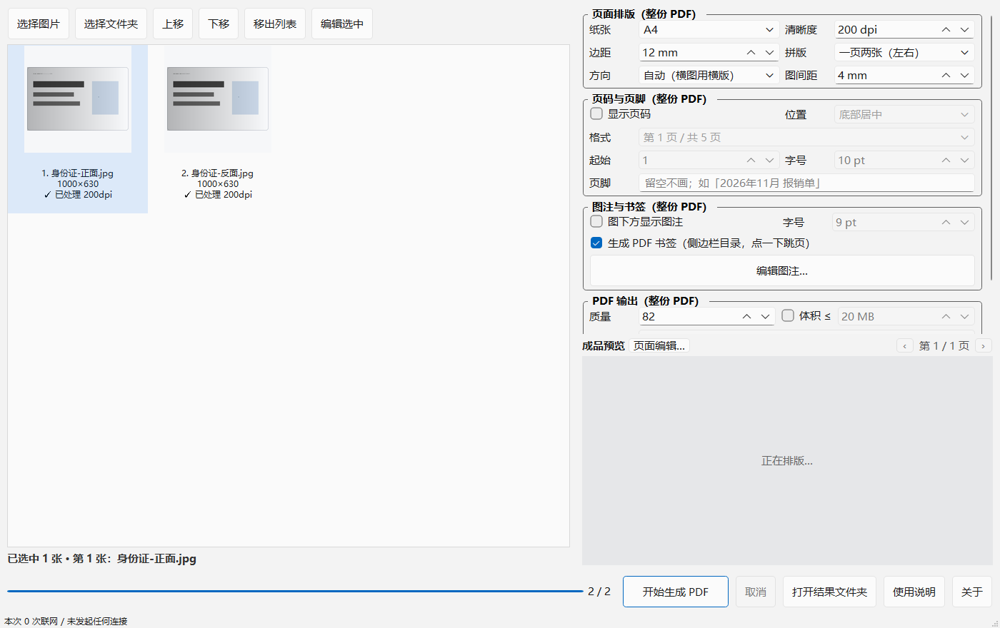

# 图片转PDF工具 · 产品介绍与功能特点

> 把照片、截图、扫描件、书页拖进来，按你自己调的参数合成一份能直接发出去的 PDF。
> 全程本地处理，不联网、不上传，原图一个字节都不改。

**版本 1.3.0** ｜ 办公工具 ｜ Windows 10 及以上 64 位 ｜ 深圳市创炫互动网络科技有限公司 · www.mrheedu.com

---

## 一、它解决什么

手机拍一张发票直接交上去，通常会被打回来：歪着、有手影、一张一个文件、体积还大。用扫描仪？家里没有。用在线转换站？发票和证件恰恰最不该上传到别人服务器。

这个工具把「把照片修成扫描件」和「合成 PDF」放在同一个本地流程里做完：左边看着缩略图，右边调整份 PDF 的版面与输出，想看单张效果就点「编辑选中」（打开即出图、参数一改立即重算），某一张拍坏了就单独修那一张，要在纸上批注就点「页面编辑…」开大窗口直接画，最后一键出 PDF。

```
手机拍 / 微信收 / 扫描仪 ──► 图片转PDF工具 ──► 报销系统 / 办事窗口 / 邮件附件 / 作业提交
```

**一个工具做到底，不用来回导。** 过去「签批一份合同」的流程是：图片合成 PDF → 导出成图片 → 打开画图软件写字画框 → 再导回 PDF。这里把后半段也收进来了：点成品预览旁的「页面编辑…」开一个独立大窗口，在里面加文字、画方框、拉箭头、涂黑遮盖、贴签名图，所见即所得，出片就是那样。

**通用，不挑图片。** 不要求先回答「这是票据还是证件」——发票、合同、试卷、书页、画册、网页截图、随手拍的照片，进来都是同一套参数，由你决定怎么处理。



---

## 二、界面怎么排的

v1.3.0 按「先看到图、再谈参数」重排过一次。上一版把参数铺满窗口上沿、右侧再挂一块常驻预览，顶部还有一排场景按钮，信息太密；这一版砍掉了这些：

主窗体只做三件事：**列表选择、页面排版、预览**。图像修复与输出不在主窗体摊开，而是收进一个「编辑选中」窗口。

| 区域 | 放什么 | 为什么 |
|---|---|---|
| **左侧** | 缩略图卡片列表 | 一眼看清有几张、什么顺序、哪张拍歪了；拖动改页序，双击进编辑 |
| **右侧上** | 四组，全是整份 PDF 的事 | 「页面排版」（纸张 / 清晰度 / 边距 / 拼版 / 方向 / 图间距）、「页码与页脚」、「图注与书签」、「PDF 输出」；不折叠、不先选场景、没有一键填值按钮 |
| **右侧下** | 成品预览 + 「页面编辑…」 | 待生成的那份 PDF 的第几页长什么样，`‹ ›` 翻页；改参数自动重排。这里只读——看清版式够用，动手改地方就点按钮，另开一个 1240×900 的大窗口 |
| **左上按钮行** | 「编辑选中」 | 打开唯一的编辑窗口：图像修复 + 存不存处理后的图；不勾「同时用于其它图片」只改这一张，勾上就是整批 |

顶部不再有「通用 / 票据报销 / 证件材料 / 作业文档」这类一键填值按钮。之前那排按钮替用户做了决定，反而不通用：书、合同、试卷、画册都不属于这几类。现在参数本身就是全部，改什么就生效什么。

---

## 三、功能特点

### 1. 缩略图列表，顺序看得见

拖入图片或整个文件夹，左边立刻出现缩略图卡片，写着页序、文件名、原尺寸。按住卡片上下拖就是改页序，也可以用「上移 / 下移」；选中按 `Delete` 移出本批（只移出清单，不删原文件）。EXIF 方向、中文路径、HEIC 都按正确方向出缩略图。



### 2. 参数分两处，改什么立刻生效

整份 PDF 的事都在主窗体右栏（四组）；只有图像本身的事收进「编辑选中」窗口，两处都没有隐藏项：

- **页面排版（主窗体）**：纸张（A4 / A5 / B5 / Letter / 自适应）、清晰度、边距、拼版、页面方向
- **图像修复（编辑窗口）**：裁边、纠偏、透视拉正（三个独立开关）、去阴影（关 / 轻 / 标准 / 强）、画面效果五档（彩色 / **彩色扫描件**——自动拉平＋纸面白化的拍照修复 / 增强扫描件 / 灰度 / 黑白 1 位无损）
- **扫描件效果**：增强档走「双边降噪 → CLAHE 局部对比度 → 轻锐化」，黑白档走随图幅缩放的局部自适应阈值；滤镜在全分辨率、去阴影之后执行，预览与成品共用同一条渲染管线
- **PDF 输出（主窗体右栏）**：JPEG 质量、目标体积、最低画质地板、输出目录——整份 PDF 的事，编辑窗口里没有

「自适应」纸张让页面跟着图片自身比例走：摊开的书、长图、横幅、网页截图都不会被压进 A4 变成一条。


### 3. 成品预览常驻，改完就能看到那页

右侧下半是「成品预览」：按当前页面排版把待生成 PDF 的整页拼出来——纸张、边距、拼版位置、多张拼一页都在里面，`‹ ›` 翻页，页数就是最终 PDF 的页数。参数一改它自动重排当前页，不用再点按钮。

拼装和出片共用同一条链路：每张先走 `render_page` 落到自己的格子（或手动摆的位置），再按 `build_pdf` 的落位规则贴到白纸上，所以看到的页就是会生成的那页。

**页码与页脚**也画在这一层：勾上「显示页码」后版心自动让出一条纸边，字落在边距里、不压图；页码与页脚互斥左右，不会互相盖住。页码用 PDF 内置中文字体，一本几十页只多几 KB——刻意不用嵌入子集（实测会多 1.7 MB），否则和「体积上限」直接冲突。

**页面编辑**是一个独立窗口。右栏那块预览只有三百来像素高，一页 A4 缩进去连正文都糊，写字只能写个大概——所以拆成两件事：右栏负责「看一眼对不对」，动手改地方就点「页面编辑…」开窗，整页铺满一屏（默认 1240×900，笔记本上按屏幕缩，同一次运行内记住大小）。

窗口里图可以拖动换位置、拖四角改大小（锁比例），配「居中 / 铺满 / 复位本页」（复位会把这一页的图退回自动落格、标注一并清掉，弹窗确认后执行，可 `Ctrl+Z` 整体撤销），`PageUp` / `PageDown` 翻页，点「完成」回主界面。位置按页面比例存在内存里，与出片共用 `render_page`，所以窗口里那个框就是 PDF 里的框。

**撤销 / 重做**（`Ctrl+Z` / `Ctrl+Y`，或工具条上的「撤销」「重做」）覆盖这里的所有动作：加标注、拖动、拖角缩放、改字号颜色、改文字、删除、挪图、居中铺满复位。做法不是记一串逆操作，而是每次改动前存一份「标注 + 每个手动位置」的全量快照——量小、不会漏状态，也不会因为「改了又拖又删」这种组合算错该退回哪。栈最多 60 步，同一处连点字号会合并成一步；只在这次运行内有效。

同一条工具条上还有五种标注——**文字、方框、箭头、涂黑、签名图**。它们挂在同一套对象模型上（`core/annotate.py`：类型 + 0–1 页面比例坐标 + 样式，其中箭头存「起点 + 带方向的位移」，画布上拖着实时预览、选中后拖两端手柄改方向长短，粗细分三档），所以拖动、`Delete` 删除、方向键微移全都复用同一套交互；文字双击或点「改字」还能改内容，文字框会按内容长高、长串英文按字宽折断，不会溢出到框外（溢出的字看得见却点不中，是最招人烦的那种坑）。

「点中已经有的一条」这条规则对五种标注一视同仁：**拿着任何工具点一下纸上已有的标注 = 选中它**，工具随即退回「选择」，接下来拖、拖角、`Delete` 才有的可做；反过来，**画完从框里直接拖是移动它**，不会在它身上再叠一条。这两条不做好，用户画完发现歪了根本改不动，只能删了重画——方框、箭头、涂黑尤其明显。

它们是矢量，改一条不用重排整页，画布即时反映。出片时用同一套几何换算画进 PDF，所以预览里那条黑块就是 PDF 里那条黑块。

**图注与书签**是两件不同的事，刻意没有合并。图注印在纸上（每张图下方一行，默认关），书签写进 PDF 大纲（阅读器侧边栏一图一项，默认开）。图注也不照抄文件名：`IMG_20261109_124512` 这类设备编号先被洗成空，不会变成一串数字印在纸上；真有意义的文件名（`合同-第3页`）才留下，下划线换成空格。几何上，图注走的是和页码同一套「让出高度」的做法——格子底部让出一条带，图注画在带里，所以不会压图；一页多张时按「本页有没有字」整页统一让，保证四格仍然一样大。

要逐张核对效果，选中那张点「编辑选中」：一块干净的画布，打开即显示这张图并自动算出当前效果，参数一改立即重算；右侧是逐张的图像修复项（裁边 / 纠偏 / 透视拉正 / 去阴影 / 画面效果），不做任何拖拽变形；下面写着处理后尺寸、页面大小、实际 DPI、页码。预览的像素尺寸与 DPI 都是真值，不是示意图。



### 4. 每张图可以单独修

一批图里常常只有某一张拍歪了、或者只有某一张有手影。双击那张（或点「编辑选中」），不勾「同时用于其它图片」，就只给它开关裁边 / 纠偏 / 透视拉正 / 去阴影 / 画面效果；窗口打开就是即时效果，满意再「应用」。裁边 / 纠偏 / 透视矫正默认全不勾——自动修复是基于估计的图像处理，默认不动原图，要用的人自己点亮。

- 应用后，缩略图上会标 `★ 单独修复`，选中说明也会提示；
- 纸张、清晰度、拼版、目标体积仍由主窗体与编辑窗口的「输出」统一决定，不跟着分叉（否则页码和体积阶梯会乱）；
- 预览和正式生成都走同一份逐张参数，不会"看着对、出来不对"；
- 哪张单独修过、修了什么，写进 `report.json` 的 `per_image_tunes`，事后可核对。



### 5. 图像修复是真的算法，不是滤镜

- **透视拉正**：找画面里最像一张纸的四边形，做透视变换拉成矩形；四角不可靠会自动跳过，退化四边形有防护
- **裁边**：按内容包围盒裁掉四周空白
- **纠偏**：霍夫直线估倾角，把拍歪的文字行摆平，**图片尺寸严格不变**——不扩大画布、不显示转出原图范围的内容、也不留白色三角。带可信度判据：要求直线数量、总长、角度聚拢程度同时达标，风景照里的斜屋檐不会被当成拍歪
- **去阴影**：只取画面里最亮的纸面像素估照明场，三档强弱；不会把深色标题栏洗成白底
- 三个几何开关彼此独立，去阴影也能单独关；褶皱、强反光、透字纸不保证救得回来，以预览为准

OpenCV 惰性加载（关掉自动矫正时冷启动连 cv2 都不读），处理在线程池里跑，界面不卡。

### 6. 体积可控，且如实说明代价

勾「目标体积」填上 MB 上限，程序先按实测体积生成，超了就按 `sqrt(目标/实际)` 反推下一档 DPI 与 JPEG 质量，最多试 4 轮；压到画质地板（默认 150 dpi，可选 96）就停手，还放不下会写明差多少 MB。跨轮复用增强结果，不重复跑图像算法。

源图分辨率本身不够时按原像素出片并写明实际 DPI，绝不放大凑数。开启体积上限后成品可能比预览略糊，界面会提前说明。

### 7. 原图只读、写盘原子、全程离线

- 转换前算指纹（小文件 SHA-256，大文件 size+mtime），转换后复核大小；**从不写回原图**
- PDF 先写 `.part` 再原子改名，中途失败不留半截文件；同名自动加 `(1)`
- 每个 PDF 配一份自己的同名 `.report.json`，另保留最近一次的 `report.json`，不覆盖上一批
- 核心代码静态扫描 0 处联网调用，运行期再挂 socket 计数，界面底部显示结论
- 可随时取消：取消不产出 PDF，进度条与「✓ 已处理」痕迹一并复位，参数自动解锁



---

## 四、参数一览

| 参数 | 可选项 | 默认 | 作用范围 |
|---|---|---|---|
| 纸张 | A4 / A5 / B5 / Letter / 自适应 | A4 | 整批 |
| 清晰度 | 72–600 dpi | 200 dpi | 整批 |
| 边距 | 0–40 mm | 12 mm | 整批 |
| 拼版 | 一页一张 / 上下两张 / 左右两张 / 2×2 四张 | 一页一张 | 整批 |
| 页面方向 | 自动（横图用横版）/ 始终竖版 / 始终横版 | 自动 | 整批 |
| 图间距 | 0–20 mm | 4 mm | 整批（一页多张时） |
| 页码 | 开关 + 位置 + 格式 + 起始页号 + 字号 | 关 | 整批 |
| 页脚文字 | 一行自定义文字 | 空 | 整批 |
| 图注 | 开关 + 逐张文字 + 字号 | 关 | 整批 |
| PDF 书签 | 开关（一图一项，写进大纲） | 开 | 整批 |
| 单张位置 / 大小 | 在页面编辑窗口里拖 | 按拼版自动 | 单张 |
| 页面标注 | 文字 / 方框 / 箭头 / 涂黑 / 签名图，位置和样式随拖 | 无 | 按页 |
| 裁边 / 纠偏 / 透视拉正 | 三个独立开关 | 界面默认全不勾 | 整批默认 + 可逐张覆盖 |
| 去阴影 | 关 / 轻 / 标准 / 强 | 关 | 整批默认 + 可逐张覆盖 |
| 画面效果 | 彩色 / 彩色扫描件（拍照修复）/ 增强（扫描件）/ 灰度 / 黑白（1 位无损） | 彩色 | 整批默认 + 可逐张覆盖 |
| JPEG 质量 | 40–95 | 82 | 整批 |
| 目标体积 | 限制 + MB 数（1–500） | 不限制 | 整批 |
| 最低画质 | 打印可辨认 150 dpi / 屏幕可看 96 dpi | 150 dpi | 整批 |
| 输出目录 | 任意文件夹 | 第一张图旁边的 `out` | 整批 |

**在哪设置**：整份 PDF 的事全在主窗体右栏——「页面排版」（纸张、清晰度、边距、拼版、方向、图间距）、「页码与页脚」、「图注与书签」与「PDF 输出」（JPEG 质量、体积上限、最低画质、保存目录）；只有图片本身的事（裁边、纠偏、透视、去阴影、画面效果）在「编辑选中」窗口；「这张在页面上摆哪儿」和「纸上多出来什么」（文字、方框、箭头、涂黑、签名图）都在「页面编辑…」开的窗口里。三处不重叠。

---

## 五、典型场景

| 你手上的东西 | 建议怎么调 |
|---|---|
| 手机拍的发票 / 小票 | 默认即可；有手影把去阴影调到「标准」，要卡附件大小勾目标体积 |
| 身份证正反面 | 拼版选「一页两张（左右）」，清晰度 300 dpi，去阴影关 |
| 摊开的书 / 长图 / 横幅 | 纸张改「自适应」，页面跟着比例走；关掉透视拉正避免误判 |
| 合同、试卷、纯文字材料 | 画面效果选「黑白（1 位无损）」，体积最小；歪了单独开纠偏 |
| 一批图里只有一张拍坏了 | 双击那张 → 只给它开关修复项 → 应用（不勾「同时用于其它图片」） |
| 截图、画册、照片 | 默认通用参数，或改「自适应」保留原比例 |



---

## 六、和在线转换站比

| | 在线转换站 | 图片转PDF工具 |
|---|---|---|
| 图片去向 | 上传到别人服务器 | 全程本地，原图不出机器 |
| 联网 | 必须 | 断网也能跑完整流程 |
| 修复 | 多数只做格式转换 | 裁边 / 纠偏 / 透视 / 去阴影可调 |
| 逐张处理 | 通常整批一个设置 | 每张可以单独修 |
| 体积 | 常有限制或要付费 | 本地反推 DPI / 质量，无页数限制 |
| 水印 / 登录 | 常见 | 无水印、不登录 |

---

## 七、验收与可靠性

- 核心引擎自检 **425 项**、界面自检 **266 项**（真的建窗口、点按钮、拖缩略图、拖标注、撤销重做、跑线程）、出厂包自检 **22 项**（打包后现场造样张跑完整链路）
- 本轮全量代码复查后新增 21 项回归验收：预览串图 / 缓存脏写、同尺寸纠偏的多通道与大角度边界、体积阶梯降质单调、`pdf_name` 目录逃逸、报告字段真实性、取消存图不留半截文件、CLI 档位一致性、关于页使用说明不再出现已退役的操作指引
- 安装 / 运行 / 正常关窗口 / 卸载 **9 项**检查：完成页无「查阅 README」勾选、装好的 exe 自检全过、关窗口不弹「Unhandled exception in script」、卸载无残留
- 在 `%LOCALAPPDATA%\Programs` 被联接（junction）到其它盘的机器上，验证过**目录不存在时的全新安装**：不再出现「错误 448 不受信任的装入点」
- 支持 JPG / PNG / WEBP / BMP / TIF / HEIC；中文路径、HEIC 写读往返、EXIF 转正、自然排序均有断言覆盖
- 命令行 `cli.py` 可脱离图形界面跑完整引擎，五档画面效果（含 `--color scan` 彩色扫描件）与界面完全一致，`--json` 输出完整报告




---

## 八、已知边界

- 去阴影与透视是**基于估计的图像处理**：褶皱纸、强反光、纸张透字不保证成功，以编辑窗口画布上看到的为准；不满意就关掉对应开关，或只改这一张
- 开启「目标体积」后成品可能比预览略糊，这是为了贴近你填的上限
- 500 张规模尚未做专项压测
- **不做** OCR 文字识别、可编辑文字层、PDF 加密 / 水印、多 PDF 合并拆分
- **不做** PDF 原生批注对象（注释 / 便签这种在阅读器里能再编辑的东西），也**不做自由手绘涂鸦**：我们的文字块、方框、箭头、涂黑、签名图是直接画进页面内容的矢量图形，出片后任何阅读器都能看，但回不到「可拖动」的状态——要改就重出一份
- 标注与手动排版位置目前**只在本次运行内有效**：关掉程序就没了，`report.json` 里留有记录但还读不回来。要么出片，要么别关
- 标注只覆盖「纸上可见的东西」，不替代阅读器里的批注、表单填写、电子签章（法律意义上的）

---

免费软件，纯本地使用；不收集、不上传任何图片或文件。
