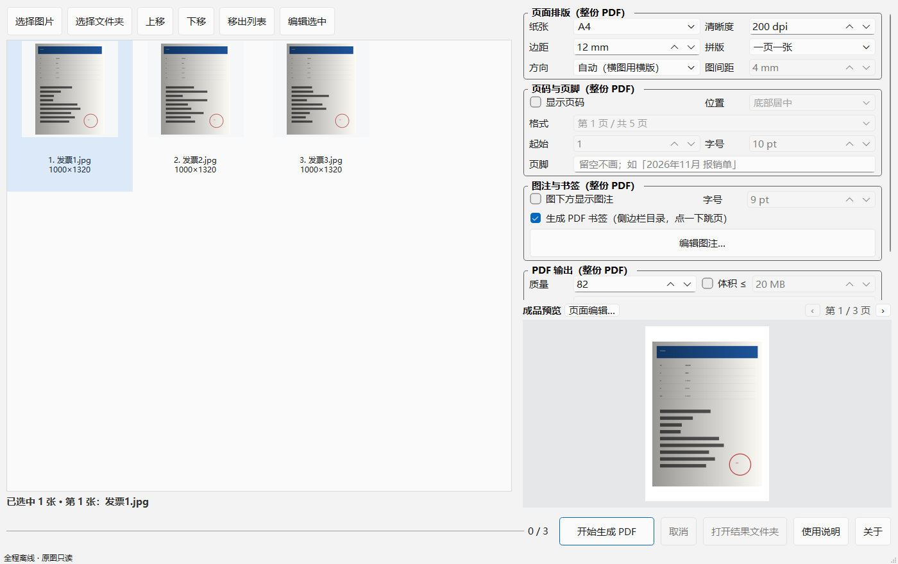
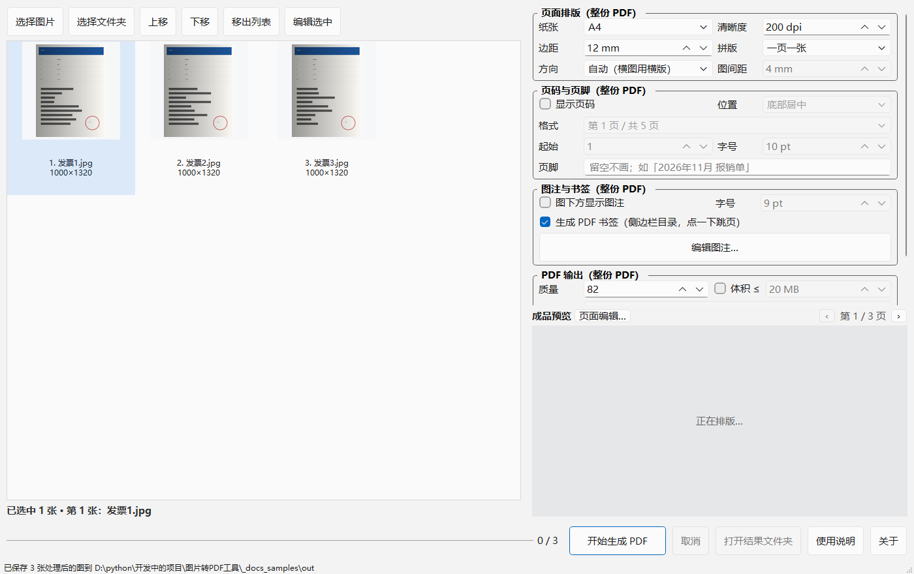
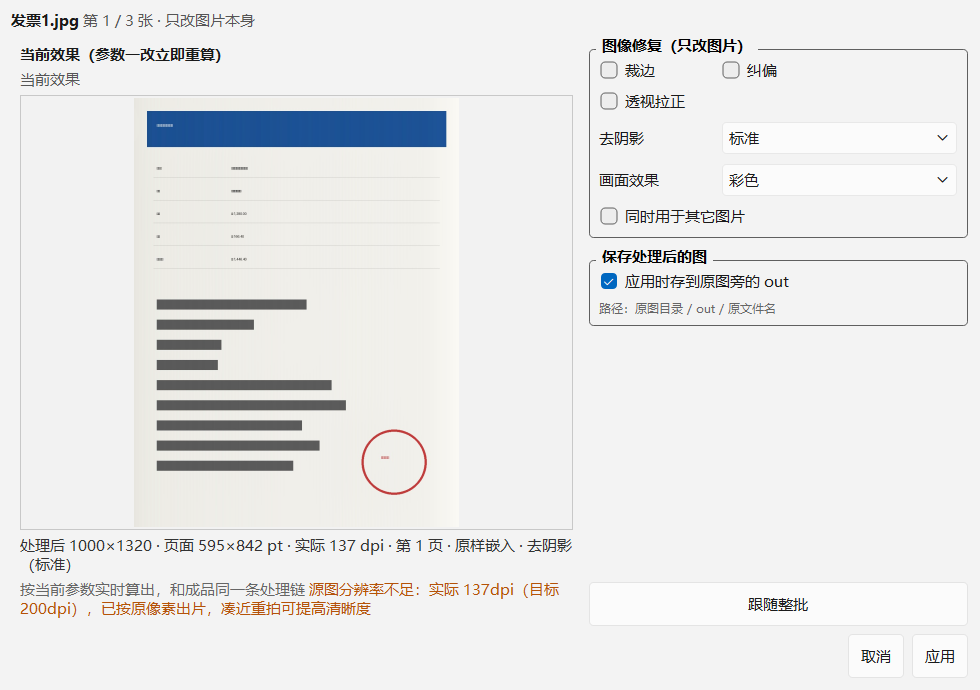
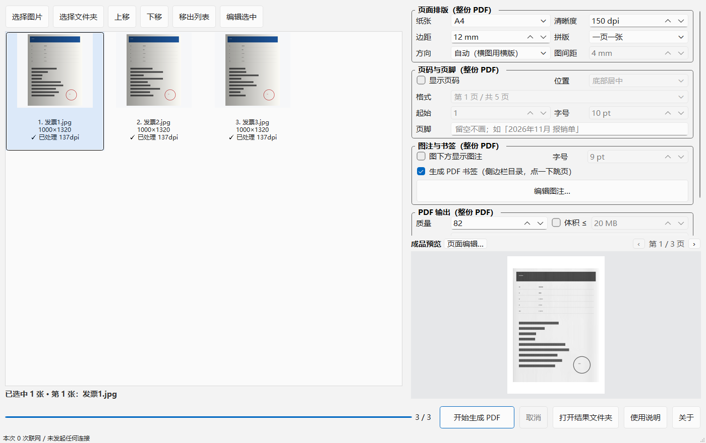
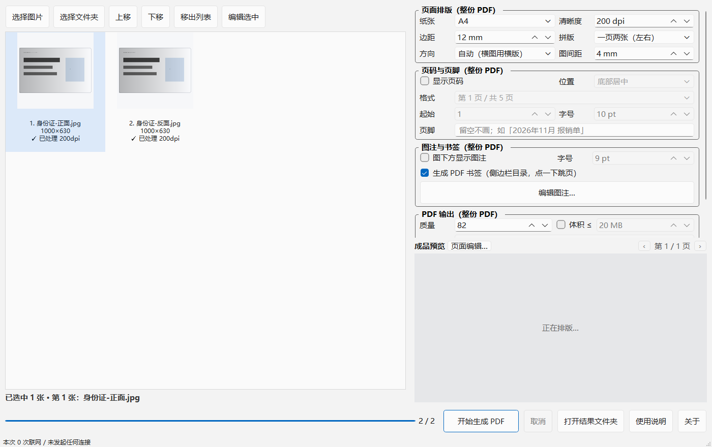
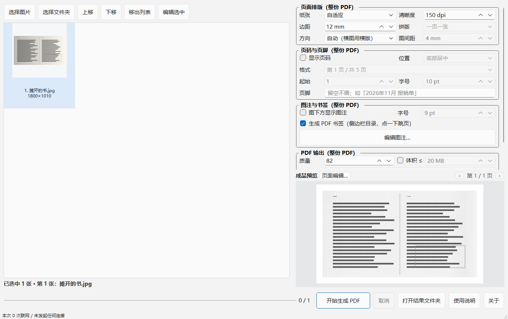
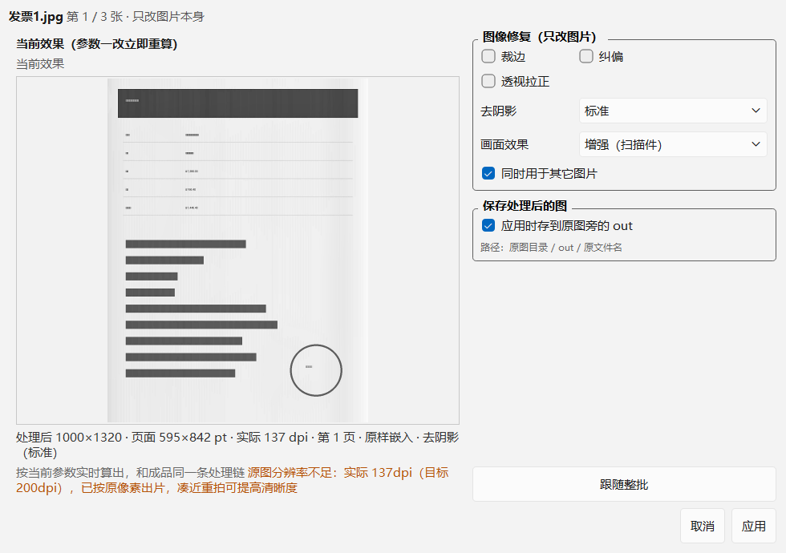
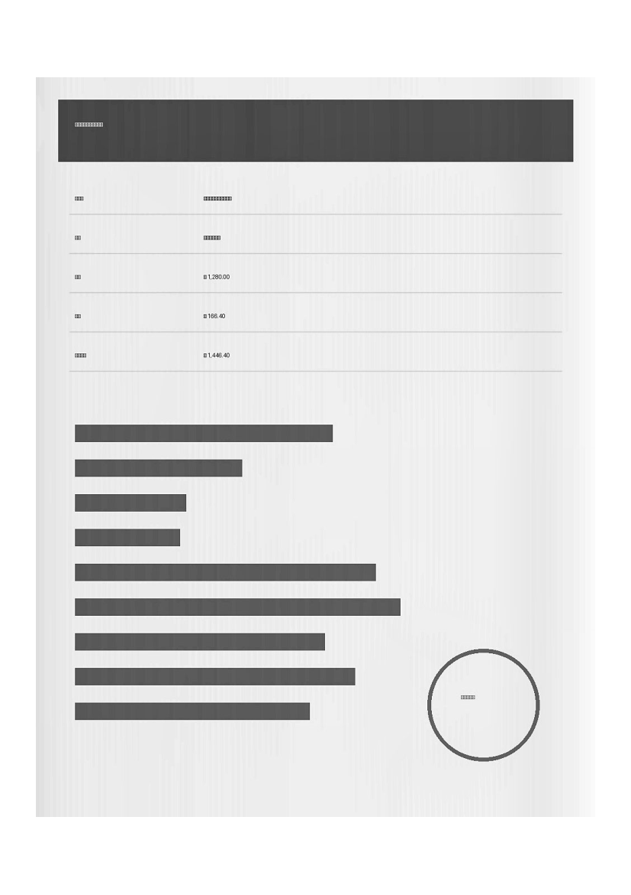

# 图片转PDF工具 · 使用教程（v1.3.0）

这份教程按「你要干什么」组织，各节都能单独看，不用从头读。第一次用先看[三步上手](#一三步上手)；只有一张拍坏了看[第四节](#四某一张拍坏了单独修这一张)；书页、长图、截图看[第三节](#三书文档长图截图用自适应纸张)。

> **先记住六句话**
>
> 1. **先分清三件事**。右栏是**整份 PDF**（页面排版 + 页码与页脚 + 图注与书签 + PDF 输出）；「编辑选中」窗口是**单张图片**（裁边 / 纠偏 / 透视 / 去阴影 / 画面效果）；点「页面编辑…」弹出的独立窗口是**这一页怎么摆、纸上写什么**（拖图、加标注）。三处不重叠，不用猜。
> 2. **改图才点按钮**。选中一张 → 点「编辑选中」；窗口里一块画布即时显示效果，参数一改立即重算，满意点「应用」。
> 3. **原图不动**。改完的图存在原图旁边的 `out` 里，PDF 另存成独立文件，重名自动加 `(1)`，绝不覆盖。
> 4. **处理是估计出来的**。裁边、纠偏、透视拉正、去阴影都可能估错，以编辑窗口画布上看到的效果为准；不满意就把对应开关关掉。纠偏尤其保守：证据不足时它就什么都不做。
> 5. **编辑过的图优先**。出片时若有 `out` 里那张修改后的图就直接用它，没编辑过的才按参数处理原图。
> 6. **摆得不对就拖，要写字就选工具**。点成品预览旁的「页面编辑…」，会开一个大窗口；图可以直接拖动、拖角改大小，同一排工具能加文字、方框、箭头、涂黑和签名图。

---

## 一、三步上手

### 第 1 步：把图拖进左边

双击打开软件，直接把图片或整个文件夹拖进窗口左侧；也可以点左上「选择图片」「选择文件夹」。

左边会立刻出现缩略图卡片，每张写着页序、文件名、原尺寸：



- **改顺序**：按住卡片上下拖，或选中后用「上移 / 下移」。列表顺序就是 PDF 页序。
- **移出本批**：选中按 `Delete` 或点「移出列表」。只是移出清单，**不删原文件**。
- 支持 jpg / png / webp / bmp / tif / heic，中文路径和手机竖拍（EXIF 方向）都能正确识别。



### 第 2 步：整份 PDF 的事都在右栏

主窗体右栏从上到下：**页面排版**、**页码与页脚**、**图注与书签**、**PDF 输出**、**成品预览**。前四块 100% 作用于整本 PDF。

| 位置 | 里面有什么 | 管谁 |
|---|---|---|
| 主窗体右栏「页面排版（整份 PDF）」 | 纸张、清晰度、边距、拼版、页面方向、图间距 | 整本 |
| 主窗体右栏「页码与页脚（整份 PDF）」 | 显示页码、位置、格式、起始页号、字号、一行页脚文字 | 整本 |
| 主窗体右栏「图注与书签（整份 PDF）」 | 图下方显示图注、图注字号、编辑图注、生成 PDF 书签 | 整本 |
| 主窗体右栏「PDF 输出（整份 PDF）」 | JPEG 质量、体积上限、最低画质、保存到哪个目录 | 整本 |
| 主窗体右栏「成品预览」＋「页面编辑…」按钮 | 待生成的那份 PDF 的一页，`‹ ›` 翻页（只读，看清版式用）；点按钮另开一个大窗口，在里面拖图、改大小、加文字 / 方框 / 箭头 / 涂黑 / 签名图，`Ctrl+Z` 撤销 | 这一页 |
| 左上「编辑选中」打开的窗口 | 裁边、纠偏、透视拉正、去阴影、画面效果 + 存不存处理后的图 | 这张（或这一批） |

编辑窗口里那组修复参数默认**只改这一张**；勾上「同时用于其它图片」就是这一批的默认值（原来那张图上的单独设置会被清掉）。点「取消」整组还原，点「应用」才生效。裁边 / 纠偏 / 透视矫正默认**全不勾**——自动修复是基于估计的图像处理，不该在用户没开口之前就动原图；需要时在窗口里自己点亮，点「跟随整批」回到整批默认（也是全不勾）。

**成品预览**按当前页面排版把整页拼出来：纸张、边距、拼版位置、多张拼一页都在里面，和正式出片走同一条渲染管线，页数也就是最终 PDF 的页数。参数一改，它会自动重排当前页。

要看某一张的效果，选中它点「**编辑选中**」，窗口里是**一块画布**（单视图、无变换手柄）：一打开就显示这张图，随后自动算出当前设置的效果并替换显示；之后**任何参数一改都会立即重算**，不用点任何按钮：



- 打开瞬间显示的是原图，一两秒内自动换成按当前参数算出的效果
- **画布只负责显示**：没有变换框 / 手柄，画布上的拖动不会改动任何参数；在右侧改裁边 / 纠偏 / 透视 / 去阴影 / 画面效果，画面立即按新参数重算
- 下面一行写着处理后尺寸、页面大小、实际 DPI、第几页、用了哪些处理

编辑窗口与正式出片是同一条处理链，看到的样子和数字就是成品的。


### 第 3 步：开始生成

点底部「开始生成 PDF」。进度条走完后，每张缩略图上会标「✓ 已处理 150dpi」，程序自动打开结果文件夹。



结果默认在第一张图旁边的 `out` 文件夹里，文件名带日期时间；也可以在右栏「PDF 输出 → 保存到」里另选。每个 PDF 旁边都有一份同名的 `.report.json`，逐张记着原尺寸、输出尺寸、实际 DPI、用了哪些处理。

---

## 二、参数怎么调

### 纸张与清晰度

- 默认 **A4 / 200 dpi / 12 mm 边距**，一页一张，够打印也够看。
- 要清晰一点就调高「清晰度」，但**源图本身不够大时不会放大凑数**——预览里会写明实际 DPI 并提示「凑近重拍可提高清晰度」。
- 证件、小字材料可以上 300 dpi；纯屏幕看的材料 150 dpi 就够。

### 拼版与方向

「拼版」一个下拉同时决定几张一页和怎么摆：

| 选它 | 效果 |
|---|---|
| 一页一张 | 一张图一页（默认） |
| 一页两张（上下） | 两张竖着叠一页 |
| 一页两张（左右） | 身份证正反面常用 |
| 一页四张（2×2） | 省纸，适合小票、草稿 |

「页面方向」默认「自动」：一页一张时横图自动换成横版，不会缩在竖页中间；也可以强制始终竖版 / 横版。



### 页码与页脚

一两页的票据、证件用不上页码，默认是关的；装订成册的材料才需要。勾上「显示页码」后：

| 项 | 说明 |
|---|---|
| 位置 | 底部居中 / 右下 / 左下 / 顶部居中 / 右上 / 左上 |
| 格式 | `1`、`1 / 5`、`第 1 页`、`第 1 页 / 共 5 页`（默认） |
| 起始 | 第一页的页号。接在打印好的文档后面时，从 7 开始编 |
| 字号 | 6–24 pt，默认 10 pt |
| 页脚 | 一行小字，如「2026年11月 报销单」，留空不画 |

三条实测过的行为，省得你担心：

- **页码不会压在图上**。勾上页码后版心会自动让出一条纸边，图缩一点，字落在边距里；
- **页码和页脚不会互相压字**。页码占了左边，页脚自动去右边，反之亦然，都是同一行；
- **「共 N 页」写的是末页号**。起始页号填 7、一共 3 页，就是「第 7 页 / 共 9 页」——像接着上一份文档编的号。

页码用的是 PDF 内置中文字体，一本几十页的 PDF 也只多几 KB。

### 图注与书签

两件独立的事，别混：

**图注**是印在纸上、每张图下方的一行小字。默认关——照片、票据这类内容自己会说话，一行说明反而是噪音；合同、病历、施工记录这种「图本身看不出这是第几页」的材料才需要。勾上「图下方显示图注」后：

| 项 | 说明 |
|---|---|
| 图注文字 | 点「编辑图注…」逐张写，也可以整批写完再改 |
| 留空 | 用文件名。程序会先洗一遍：去掉 `IMG_` / `微信图片_` / `Screenshot_` 前缀和时间戳，下划线换成空格 |
| 洗完不剩字 | 不画。整串都是日期编号的文件名不会变成一串数字印在纸上 |
| 字号 | 6–18 pt，默认 9 pt |

几个行为：

- **图会小一点点**。图注要占格子底部一条带（和页码让出纸边同一个道理），一页多张时按「这一页有没有字」整页统一让，不会一张大一张小；
- **太长会自动截断**并补省略号，不会压到旁边那一格；
- **跟着图走**。在页面编辑窗口里拖动这一张，图注会跟着它走，不会留在原地。

**书签**写进 PDF 大纲，阅读器侧边栏一图一项，点一下跳到那一页。默认开着：它不占版面、几十项也只多几 KB，几十页的扫描件要找「那张发票」全靠它。书签名优先用图注，没写图注就用文件名。

两者互不影响：图注关掉，书签照旧；书签关掉，纸上那行字照旧。

### 页面编辑：一个独立的大窗口

「拼版」给的是默认摆法，真实材料常常不听话：身份证反面想摆正、票据想缩一点让两页对齐、截图想留白写点字。这些活要看清纸面，塞在右栏那块三百来像素高的预览里做不了，所以另开一扇窗：

点成品预览旁的「**页面编辑…**」，弹出一个 1240×900 的窗口（笔记本上按屏幕自动缩），整页铺满一屏。窗口里：

1. 图上是虚线框，工具条常驻两行——不用先「打开编辑」；
2. 点一张图选中，实线框 + 四个角点；
3. 拖着图换位置；拖**角点**改大小（比例锁死，不会拉变形）；
4. 方向键微移 1 pt，`Shift` + 方向键 10 pt；
5. 「**居中**」「**铺满**」一键摆位，「**复位本页**」把这一页恢复原样：图退回自动落格，本页的文字 / 方框 / 箭头 / 涂黑 / 签名图也一并清掉——点下去之前会先弹窗列出要撤销的内容，确认了才动手，后悔按 `Ctrl+Z` 一步找回来；
6. `PageUp` / `PageDown` 换页；点「**完成**」回主界面（改动已经记下了，不用另存）。

窗口大小在同一次运行里记住：拖大一次，下次打开还是那么大。右栏那块预览始终只读，只负责「看一眼对不对」——两边看的是同一份排版，不会打架。

几条规则：

- **只在版心里挪**。拖到纸边会停在边距上，不会压进页码那条带——否则打印出来页码被图盖住，你还得回来找原因；
- **换页不靠拖**。位置只决定「这张在它那一页上摆在哪」，第几页仍由左边列表的顺序决定；要换页就拖缩略图或点「上移 / 下移」；
- **按页面比例记**。换纸型、改边距、改清晰度之后仍在原来的相对位置，不会跑到纸外；
- **和成品一致**。手动位置走的是出片同一条代码路径，预览里那个框就是 PDF 里的框，`report.json` 的 `per_image_places` 里能查到每张的坐标；
- 「自适应」纸张下**拖不了图**（那种页面本身就是这张图，没有腾挪余地），**但标注照样能加**。

### 页面标注：写字、圈重点、遮号码、盖章

批合同、圈金额、遮身份证号、盖电子章——这些过去要「导出图片 → 打开画图软件 → 再导回来」，现在在这个窗口里就做完了。工具条第一行就是这五样：

| 工具 | 怎么用 |
| --- | --- |
| **文字** | 在纸上拖一个框，松手弹出输入框；只点一下也行，会自动给一行宽的框。可换行，字多了框会自己长高（不会把第二行裁掉） |
| **方框** | 拖出矩形，长宽随意（圈重点、圈错处） |
| **箭头** | 从起点拖到终点，**往哪拖箭头就朝哪**：水平、垂直、斜线都行；选中后拖两端的手柄就能改方向和长短，粗细在工具条第二行选 |
| **涂黑** | 拖出矩形，出片时是实心黑块（遮号码、遮金额）；要白色遮盖就选中后把颜色改白 |
| **签名图** | 拖出位置后选一张 PNG / JPG。透明底会保留，四周的透明留白会被自动裁掉，所以框拖多大签名就多大 |

选中的标注是绿色角点，交互和拖图一样：**拖动移动、拖角缩放、`Delete` 删除、方向键微移**。

改文字有三种办法，都通向同一个输入框：**双击那行字**、选中后点工具条上的「**改字**」、或者干脆删了重画。写错一个字不用删了重画。

**画错了不用删了重来**：`Ctrl+Z` 撤销、`Ctrl+Y` 重做（工具条第二行最左边的「撤销 / 重做」也一样）。加一条、拖一下、拖角缩放、改字号颜色、改文字、删掉——每一步都能退回去，最多 60 步。撤销之后如果又做了新动作，先前那些「重做」就作废了，和大多数编辑器一样。

> **点一下纸上已有的标注 = 选中它**（文字、方框、箭头、涂黑、签名图都一样），不会再画一个新框；选中后工具自动退回「选择」，马上能拖、能拖角、能按 `Delete` 删。反过来，画完发现框歪了，**从框里直接拖就是移动它**，也不会再叠一条。想在同一片地方再画一个，换回对应工具、从旁边起手拖就行。

上方一行是「字号」和「颜色」：**选中某条标注时改它，没选中时改的是下一条新标注的默认值**。字号对新画出来的文字才生效，已经从「文字」切走之后想调，先点中那行字再改。

几个行为，提前知道能省一轮返工：

- **标注是矢量，改它不重排**。加一条、拖一下、改个颜色都是即时的，不会等半秒重排整页；
- **跟着页面走**。位置按页面比例存，换纸型、改边距、改清晰度之后还在原来那个相对位置；
- **涂黑是覆盖，不是删除**。本工具输出图片型 PDF，黑块盖在图上，看得见的部分确实看不到；但有人拿编辑器把黑块移走，底下原图还在。要彻底干净，先把原图里的信息抹掉再进来；
- **标注只在内存里**。关掉程序就没了（`report.json` 里留了记录）。工作到一半别急着关窗口；
- **撤销栈同样只在这次运行里**。它记的是「标注 + 每张图挪到的位置」，关掉程序清零；换图或改页序时也会清空——那时候位置和页号的对应已经变了，硬撤回去只会更乱；
- 标注和图注是两件事：图注是每张图下方那一行（跟着图走），标注是你自己拖出来的东西（想放哪就放哪）。

### 图像修复

三个几何开关**彼此独立**，可以只开一个：

- **裁边**：按内容包围盒裁掉四周空白（深色桌面背景拍纸时很有用）
- **纠偏**：把拍歪的文字行摆平，**图片尺寸始终不变**——转出原图范围的部分直接不显示，也不会像以前那样撑出一圈更大的画布和白色三角；代价只是画面边缘极轻微（小角度 <3%）地均匀收一点。只在「大量直线摆得一样齐」时才动手——风景照里本来斜的屋檐、山坡、栏杆不会被硬掰正，所以普通照片开着它也不会变歪。已做过透视拉正的图，纠偏只认**纸边残差**：纸有折痕时半页文字会翘起来，但那是纸弯了不是拍歪了，不会为了迁就文字把纸边重新转歪
- **透视拉正**：找纸的四角做透视变换；找不到可靠的四角会自动跳过，不会硬拉

**去阴影**四档：关 / 轻 / 标准 / 强。只有拍出来一半亮一半暗才需要开；证件、截图、纯白扫描件建议关，避免把浅色印章洗淡。

**画面效果**：五档，和手机扫描 App 一致，随时可改、改完立即重算。

| 档位 | 效果 | 适合 |
| --- | --- | --- |
| 彩色 | 原样，不做画面处理 | 照片、彩色证件、带印章的材料 |
| 彩色扫描件（拍照修复） | 自动找纸四角透视拉平 → 纸面白化（拍照阴影、折痕、光照不均压平）→ 轻锐化；红章、金徽等彩色内容原色保留 | 手机拍的执照、证件、证书——要「像扫描出来的彩色件」 |
| 增强（扫描件） | 双边降噪 → 局部对比度 CLAHE → 轻锐化，白底深字但保留层次 | 手机拍的文件、书页、试卷 |
| 灰度 | 只去色，保留连续层次 | 发票、浅色底纹 |
| 黑白（1 位无损） | 局部自适应阈值，纯白底黑字 | 纯文字合同、试卷，体积最小 |

半明半暗的纸用「黑白」也不会把暗的半边糊成黑块（阈值窗口随图幅缩放）；想更强地压掉阴影，再叠加「去阴影」开关。编辑窗口画布与出片共用同一条处理链，看到的就是最终效果。

### 目标体积

对方要求「附件不超过 20MB」时：勾「目标体积 ≤」，填 20，程序生成后按实测体积自动降 DPI 与 JPEG 质量往上贴，最多试 4 轮；压到「最低画质」地板（默认 150 dpi）就停手，还放不下会如实说明差多少。

> 开启体积上限后成品可能比预览略糊，这是为了贴近上限。要保真就不要勾。

---

## 三、书 / 文档 / 长图 / 截图：用「自适应」纸张

摊开的书、长图、横幅、网页截图塞进 A4，会被压成中间一条，四周全是白。把「纸张」改成「**自适应**」，页面会按图片自身比例成页：



- 选了自适应，程序会锁成「一页一张」（多张拼一页没有唯一比例）
- 建议同时把「透视拉正」关掉：书页中缝容易被误判成纸边
- 右侧「成品预览」里那一页是横的长方形，就说明排对了

---

## 四、某一张拍坏了：单独修这一张

一批图里常常只有一张歪了、只有一张有手影。**不用为了它改整批参数**：

1. 双击那张缩略图（或选中后点「**编辑选中**」）——窗口一打开，画布上先显示这张原图，一两秒内自动换成当前参数算出的效果
2. 只给它开关裁边 / 纠偏 / 透视拉正 / 去阴影 / 画面效果（**不要**勾「同时用于其它图片」）
3. 每改一项参数，画布**立即按新参数重算**，不用点任何按钮；看下面那行的处理后尺寸、实际 DPI 与处理链确认
4. 满意点「**应用**」——处理后的图会存进原图旁的 `out`，之后出片优先用它



应用后，缩略图上会标 `★ 单独修复`，选中说明也会提示。要撤销就再进一次，点「跟随整批」再「应用」。

几点说明：

- 纸张、清晰度、拼版、体积仍由右栏统一决定，不会分叉；
- 预览与正式生成都用这份单独设置，不会「看着对、出来不对」；
- `report.json` 里的 `per_image_tunes` 会写明哪张单独修过、修了什么，方便事后核对。

---

## 五、常见问题

**Q：预览里写着「实际 132dpi（目标 200dpi）」是什么意思？**
A：源图像素本身不够，程序按原像素出片、不放大凑数。想更清楚只能凑近重拍。

**Q：改了参数，预览没变？**
A：编辑窗口是即时预览——参数一改，300 毫秒防抖后自动重算，不用点按钮；右侧成品预览也会自动重排。如果状态行停在「正在准备预览…」，稍等一下大图算完即可；显示「预览失败」时把鼠标移到状态行看原因。

**Q：去阴影把字洗淡了？**
A：把去阴影调到「轻」或「关」。只有那一张有问题就进「编辑选中」单独关掉它。

**Q：生成到一半点取消，会有半截 PDF 吗？**
A：不会。取消后不产出 PDF，原图也未改动；重新点「开始生成 PDF」会整批重做。

**Q：标注能保存下来吗？关掉程序还在吗？**
A：现在只在内存里，关掉程序就没了（`report.json` 里会留一份记录，但那是给核对用的，不能读回来）。工作到一半别急着关窗口。需要「存成工程文件、下次接着改」的话提出来，这个可以做。

**Q：涂黑之后，别人还能把字还原出来吗？**
A：涂黑是「盖上去的黑块」，不是「删掉原像素」。正常看、正常打印都看不到；但拿到 PDF 的人如果用编辑工具把黑块移走，底下那张图还在。要彻底干净，先在图片编辑里把信息抹掉，再进这个流程。

**Q：签名的白底怎么办？**
A：用透明底的 PNG。程序会保留透明、并把四周的透明留白裁掉，所以框拖多大签名就多大。如果是白底 JPG，白块会跟着盖上来。

**Q：PDF 在哪？能改输出位置吗？**
A：默认第一张图旁边的 `out` 文件夹；在右栏「PDF 输出 → 保存到」里选一个文件夹即可。同名 PDF 自动加 `(1)`，不会覆盖上一批。

**Q：为什么勾了页码，图变小了一点？**
A：页码要占一条纸边，版心会自动让出来，图跟着缩一点。嫌小就把边距调大一点，页码落进边距里，版心就不用让那么多。

**Q：页码能只从第二页开始显示吗？**
A：目前只能改「起始页号」（整份从一开始编号），不能某页不显示。要接在别的文档后面，把起始页号填成接续的数字即可。

**Q：我拖好了位置，为什么生成出来一样是拖过的样子，但换张纸就全变了？**
A：位置记的是页面比例（左右上下各占百分之几），所以换纸型、改边距后会按比例跟着走。如果想让某一页回到默认摆法，点「复位本页」——它同时会清掉这一页的标注，弹窗确认后才执行，误点了按 `Ctrl+Z` 就能恢复。

**Q：能把图拖到下一页吗？**
A：不能，页面编辑窗口只管「在本页摆哪儿」。要换页请拖左边的缩略图，或选中后点「上移 / 下移」——页序由列表决定，这样才不会一拖就全乱。

**Q：为什么要显示的图注是空的，我明明勾了？**
A：那张图的文件名洗完不剩字（比如 `IMG_20261109_124512`、`微信图片_…`）。这种名字对读者没有信息量，程序不会把一串数字印上去。想让它有图注，点「编辑图注…」自己写一条。

**Q：图注和书签是一回事吗？**
A：不是。图注印在纸上，占版面；书签写在 PDF 大纲里，只在阅读器侧边栏出现，不占版面。书签名优先取图注，没写图注就用文件名。

**Q：PDF 打开没有侧边栏目录？**
A：目录写进去了，但有些阅读器默认收起侧边栏，点一下「书签 / 大纲 / 目录」按钮就能看到。用浏览器打开时部分浏览器不显示 PDF 大纲，换成阅读器即可。

**Q：会上传我的发票 / 证件吗？**
A：不会。核心代码 0 处联网调用，运行期还有 socket 计数，界面底部会显示结论；断网也能跑完整流程。

---

## 六、命令行（批量 / 自动化）

Windows 上不方便开界面时，`cli.py` 可以跑完整引擎：

```bash
python cli.py 图片或文件夹
python cli.py ./票据 --preset receipt --target 20
python cli.py ./书页 --paper 自适应 --no-perspective
python cli.py ./证件 --preset idcard --color bw --json
python cli.py ./执照 --color scan --shadow standard   # 彩色扫描件（拍照修复）
python cli.py --version
```

`--json` 会把完整报告打到标准输出，方便脚本接。命令行没有逐张覆盖开关，逐张处理请用图形界面。

---

## 七、成品长什么样


